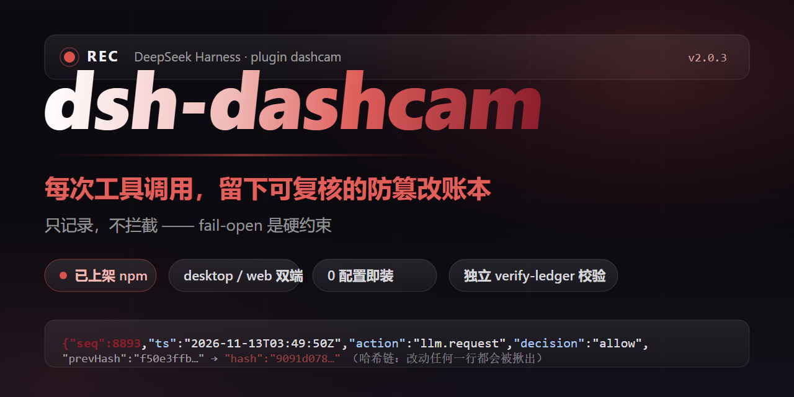
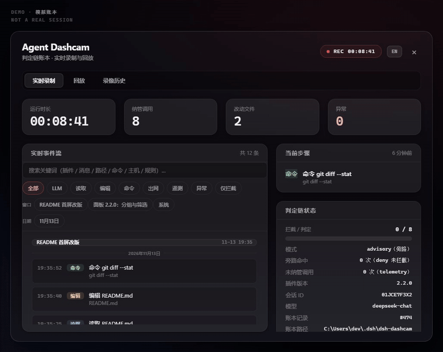
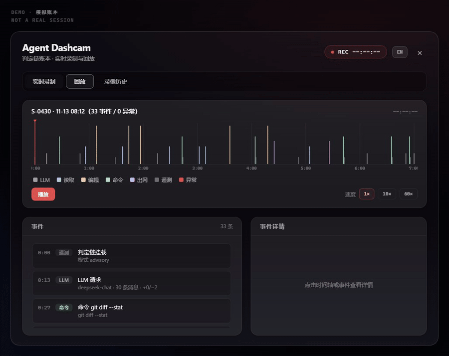
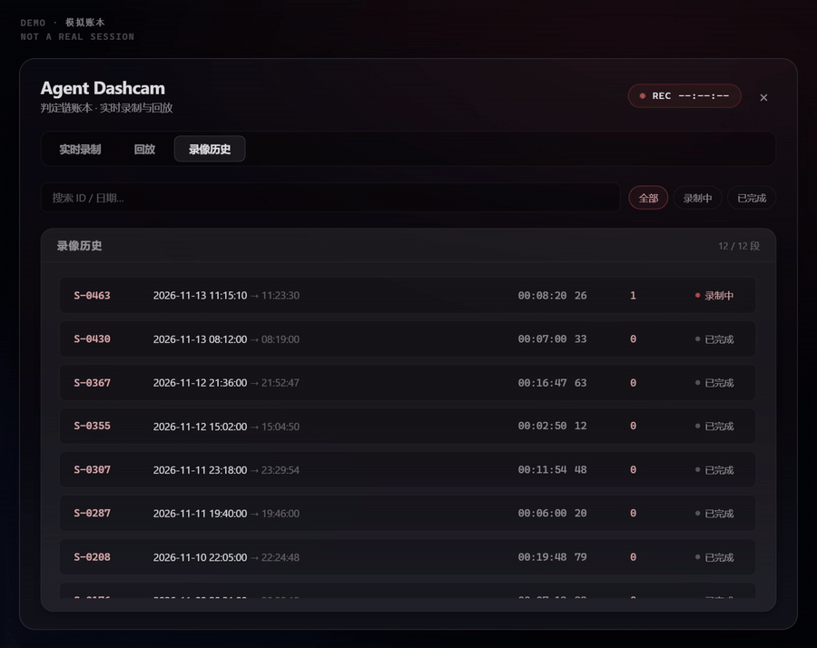

# dsh-dashcam

<p align="center"></p>

**English** | [中文](README.zh-CN.md)

   

**dsh-dashcam is a dashcam for your AI plugins. Once installed, which plugin read your `.env`, which server it contacted, and what commands it ran — most of it shows up in the panel. Works out of the box, no changes to your plugins; it records, rather than blocks or judges.**

## What you get to see

| When this happens | Without the dashcam | With the dashcam |
|---|---|---|
| A plugin breaks your config | you can't tell who did it | the ledger shows the exact plugin, file, and time |
| You wonder if a plugin sends data out | you can only trust it | every network connection is recorded, searchable by destination |
| You want to know what a plugin can do | guesswork | the ledger shows what it declared and what it was allowed |

## Install in 30 seconds

```bash
dsh plugin --profile web add dsh-dashcam
```

`--profile desktop` works the same way. Restart DeepSeek Harness — done. The default is record-only: nothing is blocked and your existing plugins need zero changes.

## Check the ledger in three seconds

```bash
# macOS / Linux
cat ~/.dsh/dsh-dashcam/ledger.jsonl | tail -5

# Windows (PowerShell)
Get-Content ~/.dsh/dsh-dashcam/ledger.jsonl -Tail 5
```

Expected output (illustrative, fields elided):

```jsonl
{"v":4,"seq":3,"ts":"2026-11-13T09:30:12Z","plugin":"dsh-dashcam-host","action":"fs.read","scope":{"paths":["README.md"]},"decision":"allow","profiled":false}
{"v":4,"seq":4,"ts":"2026-11-13T09:30:47Z","plugin":"dsh-dashcam-host","action":"net.outbound","scope":{"hosts":["registry.npmjs.org"]},"decision":"allow","profiled":false}
{"v":4,"seq":5,"ts":"2026-11-13T09:31:05Z","plugin":"dsh-dashcam-host","action":"proc.spawn","scope":{"commands":["git status"]},"decision":"allow","profiled":false}
```

Every line answers the same questions: which plugin, did what, to what target, when, and whether it was allowed.

## What the ledger looks like

Sample lines from the bundled demo ledger (`docs/screenshots/demo-ledger.jsonl`) — **demo data, not a real session** (fields elided):

```jsonl
# a plugin reading a file — which file, which plugin, exactly when
{"v":4,"seq":117,"ts":"2026-11-06T06:23:11.000Z","plugin":"dsh-demo-tools","pluginVersion":"0.4.2","capability":"fs.read","action":"fs.read","scope":{"paths":["README.md"]},"decision":"allow","reason":null,"profiled":true,"intercepted":false}
# a plugin connecting out — the destination host is right there, searchable
{"v":4,"seq":106,"ts":"2026-11-06T06:20:34.000Z","plugin":"dsh-demo-tools","pluginVersion":"0.4.2","capability":"net.outbound","action":"net.outbound","scope":{"hosts":["registry.npmjs.org"]},"decision":"allow","reason":null,"profiled":true,"intercepted":false}
# a plugin running a command
{"v":4,"seq":126,"ts":"2026-11-06T11:56:43.000Z","plugin":"dsh-demo-tools","pluginVersion":"0.4.2","capability":"proc.spawn","action":"proc.spawn","scope":{"commands":["pnpm test"]},"decision":"allow","reason":null,"profiled":true,"intercepted":false}
# a plugin declaring what it needs at startup, and being allowed to mount — profiled: true
{"v":4,"seq":104,"ts":"2026-11-06T06:20:00.000Z","plugin":"dsh-demo-tools","pluginVersion":"0.4.2","capability":"telemetry","action":"mount","scope":{"mode":"advisory"},"decision":"allow","reason":null,"profiled":true,"intercepted":false}
```

## Want to go one step further?

By default the dashcam only records. If you want plugins to **declare what they intend to do first, and act only after you approve it**, add a few lines to the plugin config (in the DSH config file `cordis.patch.yml`):

```yaml
config:
  enforce: true
  requests:                       # what the plugin declares it needs
    - capability: fs.read
      scope: { paths: ["docs/**"] }
      reason: read the docs
  grants:                         # what you allow
    - capability: fs.read
      scope: { paths: ["docs/**"] }
```

The plugin declares, you grant, and both must match before a call goes through; anything else is recorded as a would-deny (and actually rejected with `enforce: true`). Same ledger, same chain — all your existing history stays compatible.

## The panels



| Replay | History |
|---|---|
|  |  |

*The panels render demo data (`docs/screenshots/demo-ledger.jsonl`) — not a real session. Toggle with `Ctrl+Shift+D`.*

## Core features

- **Zero dependencies** — Node.js >= 20, works out of the box.
- **One command to install, one to uninstall** — uninstall removes the package itself.
- **Tamper-evident records** — every record links to the previous one, so changed records can be caught by verification. An optional HMAC key strengthens it further.
- **Stays out of the way** — if recording itself breaks, your tasks keep running; it warns loudly and does its best to mark the failure in the ledger.
- **Panels on desktop and web** — live view, replay, and session history; the panel itself speaks Chinese and English (switch in the panel header).
- **Grouped by conversation window where possible** — the live stream is organized by chat window and day (records from older ledgers may lack attribution and fall into a "System" group), with filters by event type, window, or date.
- **Ledger search** — find past events by keyword (plugin, message, path, command, host, rule…); very large ledgers may only search the recent part, and the panel says so.
- **Latest first** — the panel starts from the most recent events; older ones backfill quietly.

## Honesty and limits

Three rules the dashcam follows:

- **It does not block you.** If the ledger can't be written, calls still go through — a recording failure does not stop your task; the dashcam warns loudly and does its best to mark the failure in the ledger. (Advanced: the config key `policy.ledger.failMode: 'closed'` switches to "refuse to run when it can't be recorded".)
- **It does not lie.** A denial is written only when a call was actually denied; things that didn't happen are not reported as if they did.
- **It says what it cannot see.** Tools outside its recording scope are still recorded as observed, and the mount record states which mode is active. No blind spot is dressed up as full coverage.

**One thing worth thinking through before you install:** the ledger is sensitive data — it records exactly which files were touched and when. The recorder runs inside your agent's main process, and "it only records" is precisely why it sees what your agent sees. So install from a source you trust, keep the ledger out of backups you don't trust, and set an HMAC key (`ledgerMacKey`) if tamper-resistance matters. If you're not yet comfortable with one plugin observing another, try it in a separate test profile for a few days before making it part of your daily setup.

## Docs

- Full spec — capability scopes, ledger format, offline verification: [docs/SPEC.md](docs/SPEC.md)
- The case file that motivated the inbound-message audit: a real "user message of unknown origin" event, fully redacted: [docs/ghost-in-the-llm/](docs/ghost-in-the-llm/)
- Full version history (includes internal review notes): [docs/HISTORY.md](docs/HISTORY.md)

## Community

- More community plugins: the [official plugin marketplace](https://dsh-plugin.org/plugins)
- Questions and discussion: the [official repo Discussions](https://github.com/deepseek-ai/deepseek-harness/discussions)

## License

MIT
