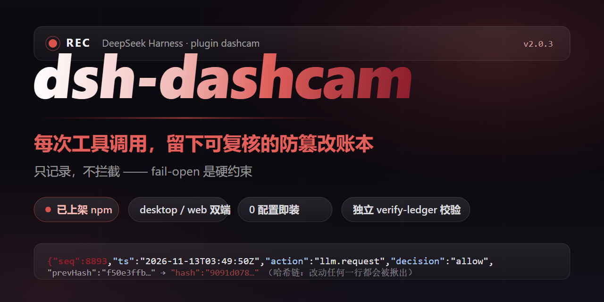
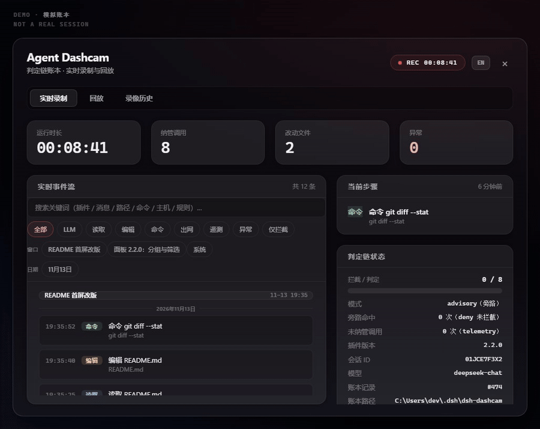
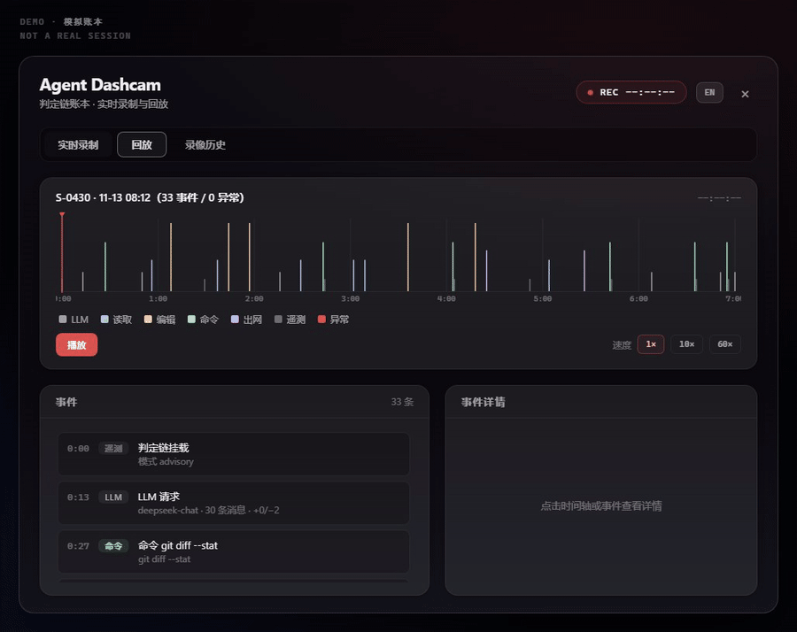
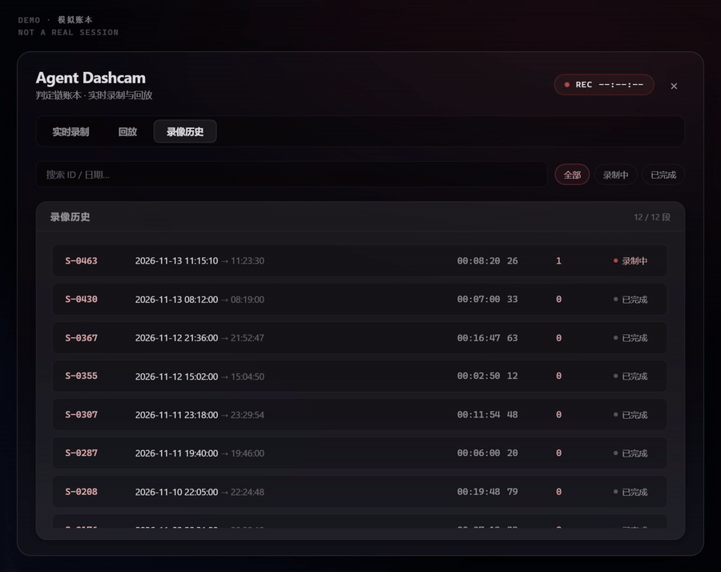

# dsh-dashcam

<p align="center"></p>

[English](README.md) | **中文**

   

**dsh-dashcam 是给 AI 插件装的行车记录仪。装上它,哪个插件读了你的 `.env`、连了哪台服务器、跑了什么命令——大多在面板里能看到。开箱即用,不用改插件;它只记录,不拦截,也不替你判断。**

## 你能看到什么

| 遇到这种事 | 以前 | 装了之后 |
|---|---|---|
| 某个插件把你的配置改坏了 | 查不出是谁干的 | 账本精确到哪个插件、哪个文件、什么时间 |
| 担心插件偷偷往外发数据 | 只能选择相信 | 每一次网络连接都有记录,目标地址可以搜 |
| 想知道某个插件到底能做什么 | 靠猜 | 账本写明它声明了什么、被允许了什么 |

## 30 秒装完

```bash
dsh plugin --profile web add dsh-dashcam
```

`--profile desktop` 同样可用。重启 DeepSeek Harness 即生效。默认只记录、不拦截,现有插件零改动。

## 三秒钟检查账本

```bash
# macOS / Linux
cat ~/.dsh/dsh-dashcam/ledger.jsonl | tail -5

# Windows(PowerShell)
Get-Content ~/.dsh/dsh-dashcam/ledger.jsonl -Tail 5
```

预期输出(示意,字段有省略):

```jsonl
{"v":4,"seq":3,"ts":"2026-11-13T09:30:12Z","plugin":"dsh-dashcam-host","action":"fs.read","scope":{"paths":["README.md"]},"decision":"allow","profiled":false}
{"v":4,"seq":4,"ts":"2026-11-13T09:30:47Z","plugin":"dsh-dashcam-host","action":"net.outbound","scope":{"hosts":["registry.npmjs.org"]},"decision":"allow","profiled":false}
{"v":4,"seq":5,"ts":"2026-11-13T09:31:05Z","plugin":"dsh-dashcam-host","action":"proc.spawn","scope":{"commands":["git status"]},"decision":"allow","profiled":false}
```

每一行都在回答同样的问题:哪个插件、做了什么、对什么目标、什么时候、放行没有。

## 装了之后,账本长这样

下面几行取自仓库自带的演示账本(`docs/screenshots/demo-ledger.jsonl`)——**演示数据,不是真实会话**(字段有省略):

```jsonl
# 一个插件读了文件——哪个文件、哪个插件、几点几分
{"v":4,"seq":117,"ts":"2026-11-06T06:23:11.000Z","plugin":"dsh-demo-tools","pluginVersion":"0.4.2","capability":"fs.read","action":"fs.read","scope":{"paths":["README.md"]},"decision":"allow","reason":null,"profiled":true,"intercepted":false}
# 一个插件连接了外部服务器——目标主机就在那里,可以搜
{"v":4,"seq":106,"ts":"2026-11-06T06:20:34.000Z","plugin":"dsh-demo-tools","pluginVersion":"0.4.2","capability":"net.outbound","action":"net.outbound","scope":{"hosts":["registry.npmjs.org"]},"decision":"allow","reason":null,"profiled":true,"intercepted":false}
# 一个插件跑了一条命令
{"v":4,"seq":126,"ts":"2026-11-06T11:56:43.000Z","plugin":"dsh-demo-tools","pluginVersion":"0.4.2","capability":"proc.spawn","action":"proc.spawn","scope":{"commands":["pnpm test"]},"decision":"allow","reason":null,"profiled":true,"intercepted":false}
# 一个插件启动时声明了自己需要什么,被允许挂载——profiled: true
{"v":4,"seq":104,"ts":"2026-11-06T06:20:00.000Z","plugin":"dsh-demo-tools","pluginVersion":"0.4.2","capability":"telemetry","action":"mount","scope":{"mode":"advisory"},"decision":"allow","reason":null,"profiled":true,"intercepted":false}
```

## 想更进一步?

默认只记录。如果你想让插件**先声明自己要做什么、你授权了才放行**,在插件配置里加几行就行(DSH 侧的配置文件 `cordis.patch.yml`):

```yaml
config:
  enforce: true
  requests:                       # 插件声明自己需要什么
    - capability: fs.read
      scope: { paths: ["docs/**"] }
      reason: 读取文档
  grants:                         # 你授予什么
    - capability: fs.read
      scope: { paths: ["docs/**"] }
```

插件先声明、你授权,两边都对上才放行;对不上的会被记成"本应拒绝"(`enforce: true` 时真的拒绝)。同一条账本,历史记录全部兼容。

## 面板预览



| 回放 | 录像历史 |
|---|---|
|  |  |

*面板由演示账本渲染(`docs/screenshots/demo-ledger.jsonl`)——不是真实会话。`Ctrl+Shift+D` 开关面板。*

## 核心特性

- **零依赖**——只要 Node.js >= 20,装完即用。
- **一条命令安装,一条命令卸载**——卸载移除包本身。
- **记录环环相扣**——每条记录都链着上一条,改过的记录验一下就现形;可选配 HMAC 密钥进一步加强。
- **不挡路**——就算记账本身出了故障,你的任务照常运行;它会大声提醒,并尽力在账本上做标记。
- **desktop 与 web 双端面板**——实时、回放、历史；面板自身支持中英切换（顶栏按钮）。
- **事件流尽量按对话窗口分组**——实时视图按聊天窗口和日期分节（早期账本的记录可能没有归属信息，会归到「系统」组），可按事件类型、窗口、日期筛选。
- **账本搜索**——按关键词找过往事件（插件、消息、路径、命令、主机、规则等）；账本很大时可能只搜最近的部分，会提示。
- **先看最新的**——面板先显示最近的事件，更早的内容在后台慢慢补齐。

## 诚实与边界

行车记录仪守三条规矩:

- **不拦车。** 账本写不进去时,调用照常放行——记账故障不挡住你的任务;它会大声提醒,并尽力在账本上落一条故障标记。(高级选项:配置键 `policy.ledger.failMode: 'closed'` 可以改成"写不进账就拒绝执行"。)
- **不撒谎。** 只有真的拒绝了,账本才写拒绝;没发生过的事,不会被说成发生过。
- **看不见就说看不见。** 记录范围之外的工具,照实际观测逐条记录;当前处于哪种模式,挂载记录里写明。不存在被包装成"全覆盖"的盲区。

**装之前值得想清楚的一件事:** 账本是敏感数据——它精确记录你碰过哪些文件、什么时候碰的。记录器跑在 agent 主进程里,"它只记录"恰恰意味着它看得见 agent 看得见的东西。所以请从可信来源安装,别把账本放进你不信任的备份,在意防篡改就配 HMAC 密钥(`ledgerMacKey`)。如果你对"一个插件观测另一个插件"还没有足够的安全感,可以先在独立的测试 profile 里试用几天,再决定要不要放进日常环境。

## 文档

- 完整规范——能力范围、账本格式、离线校验:[docs/SPEC.md](docs/SPEC.md)
- 入站消息对账功能的由来——一次真实"来源不明的用户消息"事件的完整取证档案(已脱敏):[docs/ghost-in-the-llm/](docs/ghost-in-the-llm/)
- 完整版本历史(含内部评审编号):[docs/HISTORY.md](docs/HISTORY.md)

## 社区

- 更多社区插件:官方[插件市场](https://dsh-plugin.org/plugins)
- 问题与讨论:官方仓库 [Discussions](https://github.com/deepseek-ai/deepseek-harness/discussions)

## 许可

MIT
